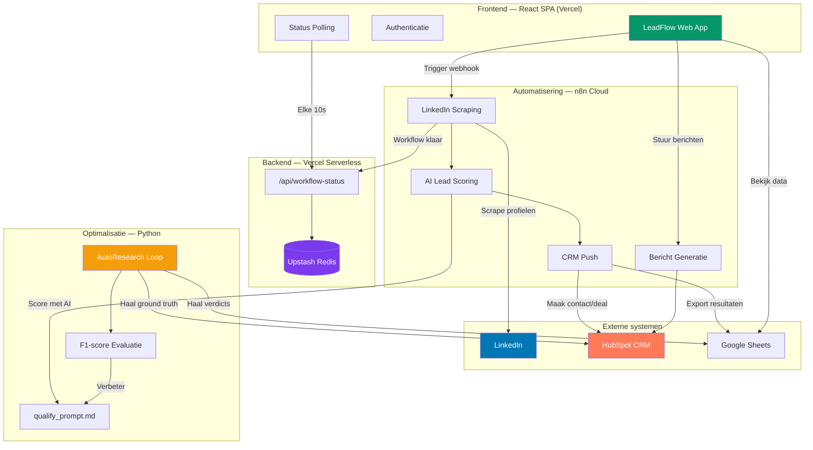

# LeadFlow — Portfolio Case

## Project samenvatting

LeadFlow is een AI-gestuurde leadkwalificatie-tool voor B2B-bedrijven. De applicatie analyseert automatisch LinkedIn-profielen, scoort ze met kunstmatige intelligentie op relevantie, en stuurt gekwalificeerde leads direct door naar het CRM-systeem. Wat voorheen uren handmatig speurwerk kostte, gebeurt nu met één druk op de knop.

---

## Probleem & Oplossing

### De situatie vóór LeadFlow

Een B2B-salesteam besteedde dagelijks **2-3 uur** aan het handmatig doorzoeken van LinkedIn-profielen. Per profiel moesten ze inschatten: past deze persoon bij onze doelgroep? Is het bedrijf relevant? Zit de persoon in de juiste regio? Dit leidde tot:

- **Inconsistente beoordeling** — De ene collega kwalificeerde strenger dan de andere
- **Gemiste leads** — Bij drukte werden potentiële klanten over het hoofd gezien
- **Trage opvolging** — Tegen de tijd dat een lead beoordeeld was, was het momentum weg
- **Geen leereffect** — Er was geen feedback-loop om de kwalificatiecriteria te verbeteren

### De oplossing

LeadFlow automatiseert het volledige proces van LinkedIn-profiel tot CRM-contact:

1. **Automatisch scrapen** van LinkedIn-profielen uit posts, campagnes of comments
2. **AI-scoring** op 5 dimensies (functietitel, branche, bedrijfsgrootte, geografie, signalen)
3. **Directe doorstroom** naar HubSpot CRM voor gekwalificeerde leads
4. **Twijfelgevallen** worden apart gezet voor snelle handmatige beoordeling
5. **Zelflerend systeem** dat de scoringscriteria continu optimaliseert op basis van resultaten

### Het resultaat

Een consistent, schaalbaar kwalificatieproces dat 24/7 draait. Het salesteam focust alleen nog op leads die er écht toe doen.

---

## Tech stack

| Categorie | Technologieën |
|-----------|--------------|
| **Frontend** | React 18, Vite, React Router v6, Tailwind CSS, Framer Motion |
| **UI Components** | Radix UI (25+ componenten), Shadcn/UI, Lucide Icons |
| **Formulieren** | React Hook Form, Zod (validatie) |
| **State management** | React Query (TanStack), React Context API |
| **Backend (serverless)** | Vercel Serverless Functions (Node.js) |
| **Database** | Upstash Redis (serverless, workflow-status met TTL) |
| **CRM** | HubSpot (contacts, deals, pipeline tracking) |
| **Automatisering** | n8n (workflow orchestratie, webhooks) |
| **AI / Machine Learning** | Claude API (leadclassificatie), Groq LLM (alternatief) |
| **Data & Spreadsheets** | Google Sheets (8+ gekoppelde sheets voor data & verdicts) |
| **Scraping bron** | LinkedIn (via n8n workflows) |
| **Prompt optimalisatie** | Python (evaluatie-loop met F1-score meting) |
| **Hosting & Deploy** | Vercel (auto-deploy vanuit GitHub) |
| **Versiebeheer** | Git + GitHub |

---

## Architectuur

### High-level overzicht

LeadFlow bestaat uit drie lagen:

1. **Frontend (React SPA)** — Mobiel-eerst webapplicatie waarmee gebruikers workflows starten, resultaten bekijken en leads beheren. Gehost op Vercel.

2. **Automatiseringslaag (n8n + Serverless API)** — n8n workflows scrapen LinkedIn, scoren profielen met AI en pushen resultaten naar HubSpot. Een Vercel serverless functie handelt de communicatie af tussen n8n en de frontend via Upstash Redis.

3. **Optimalisatielaag (Python AutoResearch)** — Een iteratieve feedback-loop die de AI-scoringsprompt continu verbetert door resultaten te meten tegen werkelijke dealuitkomsten uit HubSpot en handmatige beoordelingen.

### Architectuurdiagram

---

## Belangrijkste features

### 1. One-click workflow launcher
Start een volledige lead-kwalificatieronde met één tik. Kies uit vier modi: alle posts, specifieke posts, campagne-leads of comment-interacties. De app toont realtime voortgang en een succesmelding wanneer de workflow klaar is.

### 2. AI-gestuurde lead scoring
Elk LinkedIn-profiel wordt automatisch gescoord op vijf dimensies: functietitel (30%), branchefit (25%), bedrijf & schaal (20%), geografie (15%) en pain-point signalen (10%). Leads krijgen een score van 0-100 en worden ingedeeld als GO, MAYBE of NO-GO.

### 3. Slimme daglimieten
Elke workflow-modus heeft een limiet van 5 runs per dag. Dit voorkomt overbelasting van de LinkedIn-scraping en houdt het gebruik beheersbaar. De app toont visueel hoeveel runs er nog over zijn.

### 4. Automatische CRM-integratie
Gekwalificeerde leads worden direct als contact aangemaakt in HubSpot, inclusief alle verzamelde profieldata. Geen handmatig kopiëren meer — van LinkedIn naar CRM in minuten.

### 5. Maybe-leads triage
Leads met een score tussen 35-49 worden apart gezet voor snelle handmatige beoordeling via Google Sheets. De gebruiker hoeft alleen "JA" of "NEE" in te vullen — deze verdicts worden vervolgens gebruikt om het AI-model te verbeteren.

### 6. Zelflerend scoringssysteem (AutoResearch)
Een geautomatiseerde optimalisatieloop meet de nauwkeurigheid van de AI-scoring tegen werkelijke dealresultaten uit HubSpot. Het systeem identificeert fouten, past de scoringscriteria aan en meet opnieuw — een continu verbeterproces.

### 7. Gepersonaliseerde berichtgeneratie
Vanuit de app kan met één klik een gepersonaliseerd outreach-bericht gegenereerd worden voor gekwalificeerde leads, gebaseerd op hun profieldata en interesses.

### 8. Uitgebreide gebruikersgids
Een ingebouwde interactieve handleiding met 9 secties die het volledige systeem uitlegt — van workflow-modi tot scoringslogica. Geen externe documentatie nodig.

---

## Automations & AI

### Automatisering 1: LinkedIn Lead Scraping & Scoring

| | |
|---|---|
| **Trigger** | Gebruiker klikt op een workflow-knop in de app |
| **Wat gebeurt er** | n8n workflow scrapt LinkedIn-profielen uit posts/campagnes → AI scoort elk profiel op 5 dimensies → Resultaten worden opgeslagen in HubSpot en Google Sheets → Frontend krijgt een completion-signaal via Redis |
| **Doorlooptijd** | Enkele minuten (volledig automatisch) |
| **Opbrengst** | Leads worden consistent en objectief beoordeeld, zonder handmatig LinkedIn-werk |

### Automatisering 2: Realtime workflow status tracking

| | |
|---|---|
| **Trigger** | Start van een workflow |
| **Wat gebeurt er** | Frontend pollt elke 10 seconden de serverless API → n8n stuurt een callback wanneer de workflow klaar is → Redis slaat de status op met 1 uur TTL → Frontend toont een toast-melding bij voltooiing |
| **Opbrengst** | Gebruiker hoeft niet te wachten of handmatig te vernieuwen — het systeem meldt zich vanzelf |

### Automatisering 3: Bericht generatie voor leads

| | |
|---|---|
| **Trigger** | Gebruiker klikt "Genereer bericht" bij een gekwalificeerde lead |
| **Wat gebeurt er** | Webhook triggert n8n workflow → AI genereert een gepersonaliseerd bericht op basis van profieldata |
| **Opbrengst** | Consistent, gepersonaliseerd outreach zonder handmatig schrijven |

### AI-integratie: AutoResearch optimalisatieloop

| | |
|---|---|
| **Trigger** | Handmatig gestart wanneer voldoende nieuwe data beschikbaar is |
| **Wat gebeurt er** | Python-script haalt ground truth op uit HubSpot (deal-uitkomsten) en Google Sheets (handmatige verdicts) → AI classificeert 182+ leads → F1-score, precision en recall worden berekend → Fouten worden geanalyseerd → Scoringsprompt wordt aangepast → Cyclus herhaalt |
| **Huidige prestatie** | F1-score: 0.61, Recall: 83% (8 van 10 goede leads worden gevonden) |
| **Opbrengst** | Het systeem wordt met elke iteratie nauwkeuriger — een zelflerend kwalificatiemodel |

---

## Metrics & Impact

### Tijdsbesparing

| Activiteit | Vóór LeadFlow | Met LeadFlow | Besparing |
|-----------|--------------|-------------|-----------|
| LinkedIn-profielen doorzoeken | ~2-3 uur/dag | 0 minuten (automatisch) | **~12 uur/week** |
| Profiel beoordelen & scoren | ~3 min/profiel | 0 (AI doet het) | **~90% sneller** |
| Lead invoeren in CRM | ~2 min/lead | 0 (automatisch) | **~100% geautomatiseerd** |
| Outreach-bericht schrijven | ~10 min/bericht | ~1 min (AI-gegenereerd) | **~90% sneller** |

### Geschatte impact

- **~50-60 uur/maand** bespaard aan handmatig leadkwalificatiewerk
- **Consistente scoring** — geen verschil meer tussen beoordelaars
- **Hogere lead-dekking** — meer profielen worden geanalyseerd dan handmatig haalbaar is
- **Snellere opvolging** — leads worden binnen minuten verwerkt in plaats van dagen
- **Continue verbetering** — het AI-model wordt steeds nauwkeuriger door de feedback-loop

---

## Screenshots / UI-beschrijvingen

Hieronder de belangrijkste schermen om te screenshotten voor het portfolio:

### 1. Login-scherm
Clean login met e-mail en wachtwoord. Premium uitstraling met glasmorfisme-effect en gradient achtergrond.

### 2. Home / Dashboard
Vier workflow-kaarten (Alle Posts, Specifieke Posts, Campagnes, Comment Posts) met voortgangsbalken voor daglimieten. Elke kaart heeft een duidelijke start-knop en toont het aantal resterende runs.

### 3. Workflow geactiveerd (successcherm)
Bevestigingspagina met animatie na het starten van een workflow. Toont welke modus actief is.

### 4. Interacties & Redenering
Overzicht met vier kaarten die linken naar Google Sheets: Post Interacties, Campagne Interacties, Comment Interacties en AI Redenering.

### 5. Maybe Leads
Uitlegkaart over het handmatige beoordelingsproces met directe link naar de Google Sheet voor het invoeren van verdicts.

### 6. Gevalideerde Leads (Send Message)
Overzicht van gekwalificeerde leads met mogelijkheid om berichten te genereren en de link naar HubSpot.

### 7. Client Database
Directe toegang tot het HubSpot CRM-contactoverzicht.

### 8. Gebruikersgids
Interactieve accordion-pagina met 9 secties die het volledige systeem documenteert. Laat zien dat het systeem zichzelf uitlegt.

---

## Complexiteit indicatie

| Metric | Waarde |
|--------|--------|
| **Totaal bronbestanden** | ~45 bestanden |
| **Regels code (frontend)** | ~6.750 (incl. UI-componenten) |
| **Regels code (custom logic)** | ~1.900 (excl. Shadcn/UI library) |
| **Regels code (Python backend)** | ~390 |
| **Regels code (serverless API)** | ~50 |
| **Aantal pagina's/schermen** | 8 |
| **UI-componenten** | 50+ (Radix/Shadcn) |
| **Externe integraties** | 6 (LinkedIn, n8n, HubSpot, Google Sheets, Upstash Redis, Claude AI) |
| **API endpoints** | 2 (GET/POST workflow-status) |
| **Webhook koppelingen** | 2 (workflow trigger + bericht generatie) |
| **Google Sheets koppelingen** | 8+ sheets |
| **Omgevingsvariabelen** | 7 |
| **Programmeertalen** | 3 (JavaScript/JSX, Python, CSS) |
| **Geschatte bouwtijd** | 4-6 weken (design, development, integraties, optimalisatie) |

### Wat maakt dit project complex?

- **Full-stack**: Frontend, serverless backend, Python-scripts en workflow-automatisering
- **Meerdere externe systemen**: LinkedIn, n8n, HubSpot, Google Sheets en Redis moeten naadloos samenwerken
- **Realtime communicatie**: Polling-mechanisme met Redis als tussenlaag voor workflow-status
- **AI-integratie**: Niet alleen AI-scoring, maar ook een zelflerend optimalisatiesysteem
- **Productie-kwaliteit**: Authenticatie, daglimieten, foutafhandeling, mobiel-eerst design en auto-deploy

---

*Dit project is gebouwd als een volledig operationeel product — niet als prototype. Het draait dagelijks in productie en wordt continu verbeterd door de ingebouwde AI-optimalisatieloop.*
